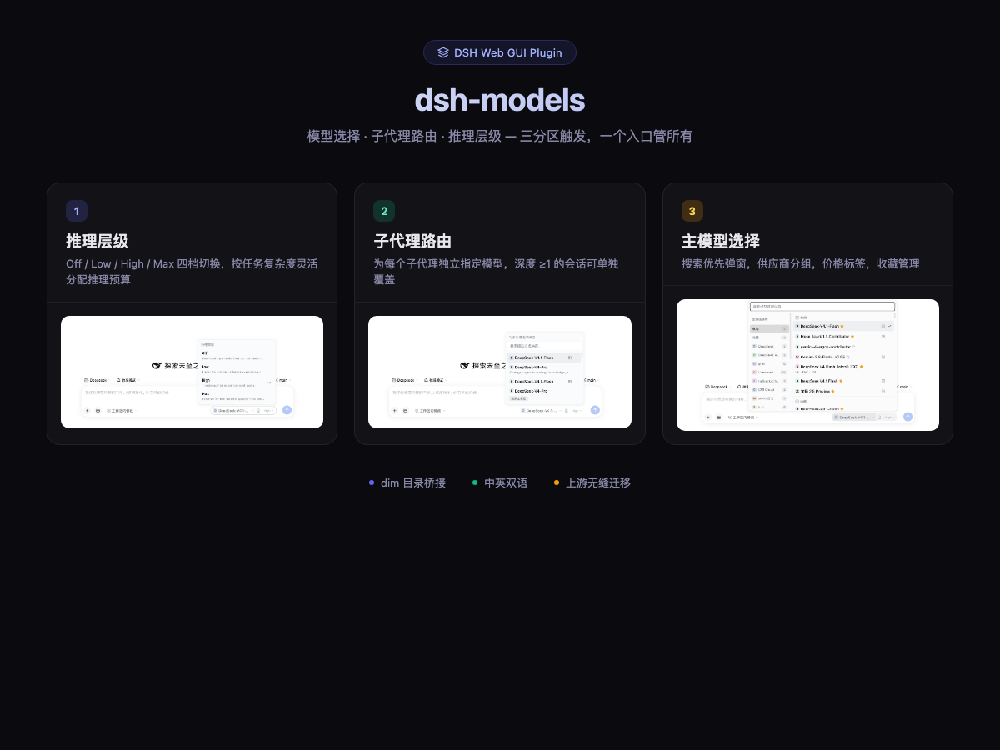
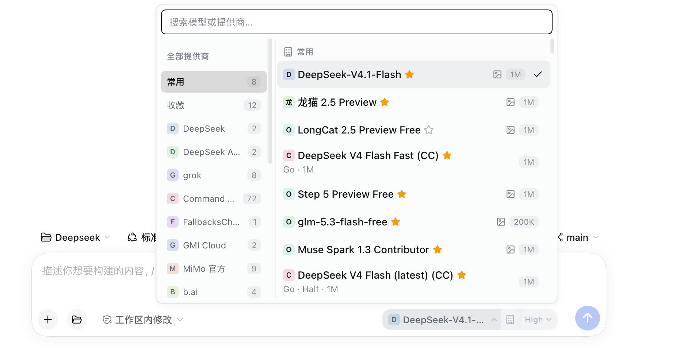

<div align="center">

[English](README.md) | [简体中文](README.zh.md)

</div>

# dsh-models

<div align="center">
  
</div>

## 实际效果 / Actual UI

<div align="center">
  
</div>

## 一句话

dsh 网页端的模型菜单——模型、思考强度、子代理用什么模型，都在输入框的模型座上点一下搞定。

## 这是什么

[ttmouse/dsh-model-picker](https://github.com/ttmouse/dsh-model-picker)
（v1.18.0 基线）的更名维护分支。上游把输入框模型座换成了搜索优先的弹窗；本分支保留这一点，并补上多模型日常使用的几个部件。

**三区触发按钮**，三个 concerns 三个弹窗：

| 区域 | 点击 | 弹窗内容 |
|------|------|----------|
| **左**（模型名） | 打开模型选择器 | 搜索框（自动聚焦）＋供应商列＋模型列表（含价格徽章与 `dim` 发现行） |
| **中**（子代理图标） | 打开子代理选择器 | 按会话覆盖子代理（depth ≥ 1）用的模型 |
| **右**（强度） | 打开强度选择器 | 可用的 reasoning-effort 档位 |

另有设置页「模型选择」卡片：发现总开关、发现模型的忽略/恢复、隐藏模型管理——与选择器实时联动。

## 来源说明

上游：[ttmouse/dsh-model-picker](https://github.com/ttmouse/dsh-model-picker)
（MIT）。本仓把包改名为 `dsh-models` 并维护增强构建（子代理路由、`dim`
桥、设置卡片、中英双语、自定义背景色、主题可读性修复）。HTTP 路由
（`/api/model-picker/…`）与 `dsh.modelPicker.*` 存储键保留上游命名，旧偏好
（收藏、隐藏、子代理路由）无缝迁移。

## 安装

需要 harness ≥ 0.2.0-rc.1（在 0.2.0-rc.2 上实测，0.2.1-alpha.3 在跑）。

```sh
curl -fsSL https://raw.githubusercontent.com/taxueseek/dsh-models/main/install.sh | sh
# 重启 dsh web
```

等价手工操作：

```sh
dsh plugin --profile web add git+https://github.com/taxueseek/dsh-models.git
# 重启 dsh web
```

> npm 上的 `dsh-models` 是无关的第三方占位包——只许用上面的脚本或 git
> 命令安装。

## 兼容性

| dsh-models | Harness | 说明 |
| --- | --- | --- |
| 0.1.4 | **0.2.1-alpha.3（当前，在跑）** | 列表虚拟化 + dim 刷新节流；座位与路由面不变。 |
| 0.1.0 | 0.2.0-rc.2（实测） | 与线上在跑的增强构建代码一致；客户端按官方版本座位表解析。 |

需要 Node.js ≥ 22.19。

在 0.2.0-rc.2 上实际验证过（更名前构建，代码一致）：

- **座位有效**：`conversation.input.model`、`web-ui.plugin.item`；用到的图标
  都在官方浏览器名册里。
- **避开已死座位**：不使用 alpha.2 已移除的 `settings.plugin.item`；设置卡片
  以无 `locale` 字段的平铺 section 渲染（带 `locale` 的条目会整卡隐形）。
- **服务端设置通道当前不可用**（`scope.set()` 恒 false），卡片偏好走
  `localStorage`（`dsh.modelPicker.*` ＋跨标签页事件），不走 `webUiSettings`。

## 配置

宿主侧暂无配置项——bundle 条目不带 `config` 段。用户偏好（发现开关、
忽略/发现模型、隐藏模型、背景色、按会话子代理路由）都在设置页卡片和选择
器里管理。

## `dim` 桥（可选）

检测到 `dim` CLI（`PATH` 里的 `dim` 或 `~/.local/bin/dim`）时，宿主把它的
目录并入模型事实：价格徽章、maxOut/发布时间，以及 dsh 目录没有而 `dim`
有的新模型发现行（每家最多 30 个，按最新排序）。没有 `dim` 时选择器与上游
行为一致——桥接自动降级为纯目录事实。

## 测试与性能

- **`npm test`** — 两套纯 Node 测试：`scripts/host-route.mjs` 驱动真实路由
  处理器（事实缓存、子代理路由、错误守卫），`scripts/interaction.mjs` 在
  jsdom 里渲染选择器并驱动打开/搜索/收藏/强度/虚拟列表窗口，共 92 项断言。
  宿主 peer 依赖缺失时自动 SKIP，任何机器上都是绿的。
- **冷启动不阻塞** — `/api/model-picker/models` 冷缓存时先回快 503，目录
  重建放后台跑（实测：首次响应 ~3ms，~3 秒内暖到 200）；客户端对 503 退避
  重试，事实一落地价格徽章就出现。暖缓存走 stale-while-revalidate。
- **列表虚拟化** — 弹窗只挂载视口附近的行（线上 310 行里 ~13 行），撑开
  两个占位 div 保持总高与滚动条不变；组头滚出窗口时由同式样的合成头钉在
  顶部。线上实测：开门 58.7 → 23.5ms（中位），DOM 节点 5506 → 1170；真实
  浏览器 bench：整轮交互累计渲染 243 → 65ms。行高由「有无描述行」确定
  （38/50px），不测 DOM，滚动数学零重排。dim 目录 60s → 10min 刷新，
  宿主每分钟省 ~1.5s CPU。细节见 [CHANGELOG](CHANGELOG.md)。

